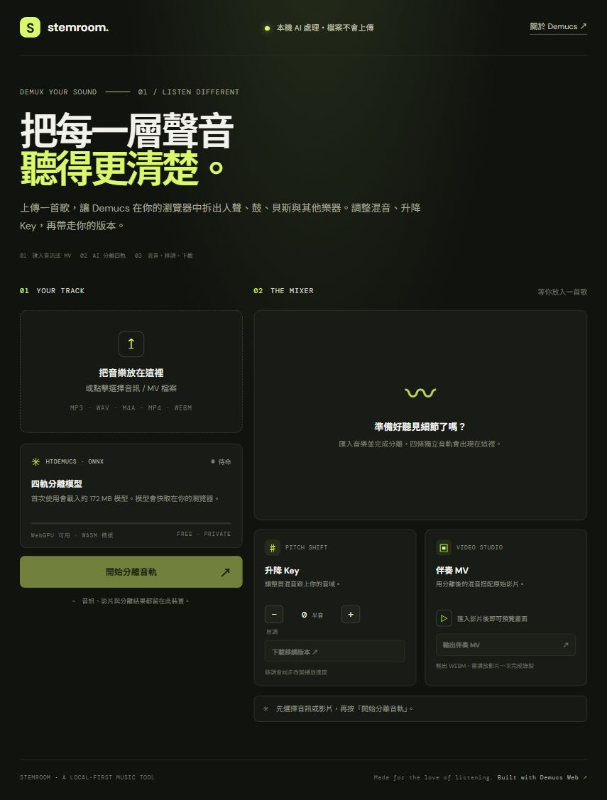

# Stemroom — Demucs MV Studio

繁體中文純前端音樂分軌工具。開啟本站後，音訊分析會在你的瀏覽器本機執行；選取的音訊與影片不會上傳。

## 功能

- HTDemucs 四軌分離：人聲、鼓組、貝斯、其他樂器。
- 每軌試聽、音量、獨奏、靜音與 WAV 下載；可混音並下載伴奏。
- 升降 Key ±6 半音。移調會同步改變播放速度。
- 匯入音訊或影片；可保留原影片畫面，錄製 WEBM 伴奏 MV。
- 首次使用從 Hugging Face 載入約 172 MB 模型，瀏覽器可快取模型供下次使用。

完整原始碼、開發 workflow 與授權文字在 [`stemroom-source.zip`](stemroom-source.zip)。

分離模型與運算核心依據 [timcsy/demucs-web](https://github.com/timcsy/demucs-web) 移植；使用 MIT License。影片輸出由瀏覽器即時錄製，需等影片播放完。
