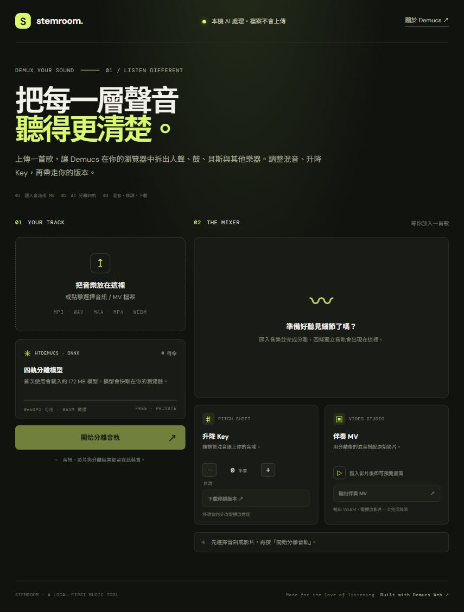

# 新增功能一覽

1. **音訊 / MV 匯入**：拖放音訊與常見影片格式，影片可預覽並擷取音軌。
2. **四種音軌分離**：HTDemucs 分成人聲、鼓組、貝斯與其他樂器。
3. **Stem 混音器**：各軌獨奏、靜音、音量調整、同步試聽及重設混音。
4. **WAV 匯出**：各音軌、混音伴奏、升降 Key 後的混音。
5. **升降 Key**：±6 半音控制；此簡易移調會同步改變速度。
6. **伴奏 MV**：使用原影片畫面和調整後混音錄製 WEBM。
7. **隱私設計**：媒體只在使用者瀏覽器處理，不送到網站伺服器。

GitHub Pages 部署為靜態網站；首次使用會載入約 172 MB 的 HTDemucs 模型，之後可使用瀏覽器快取。
